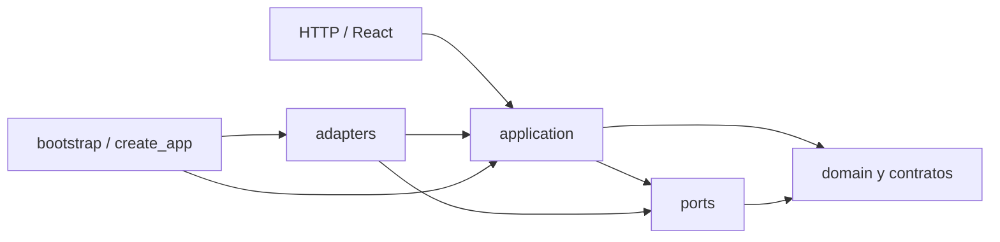

# Arquitectura modular hexagonal

El sistema es un **monolito modular**: cada capacidad posee sus casos de uso y sus adaptadores. El dominio y los contratos no importan FastAPI, Pandas, SciPy, SQLAlchemy ni LangGraph.

Esta organización sustituye las carpetas globales por capa de develop `4aaa945cd10c43ca5f3e015a76443f905af4271d`. Conserva algoritmos, cuerpos HTTP, diez rutas y el arranque `app.api.main:app`.

## Estructura real

```text
app/
├── api/
│   ├── main.py                  # composición HTTP y ciclo de vida
│   └── routes/health.py
├── bootstrap.py                 # inyección de implementaciones
├── modules/
│   ├── data_intake/
│   │   ├── domain/              # clasificación pura de columnas
│   │   ├── application/         # agentes, servicios y casos de uso de intake
│   │   ├── ports/               # fuentes, comprensión, datasets y uploads
│   │   └── adapters/
│   │       ├── datasource/      # CSV/TSV, temporales y store en memoria
│   │       └── http/            # rutas y dependencias FastAPI
│   ├── exploration/
│   │   ├── application/         # ExploreDataset y DTO de exploración
│   │   └── adapters/
│   │       ├── analytics/       # profiling, medidas, ranking y matriz
│   │       ├── visualization/   # especificaciones de gráficos
│   │       ├── http/
│   │       └── relationship_screening.py
│   ├── analysis/
│   │   ├── application/         # Planner, Analysis, Association, planes y casos de uso
│   │   ├── ports/               # Agent, AnalysisWorkflow, RelationshipScreening, ANOVA summary
│   │   └── adapters/
│   │       ├── analytics/       # herramientas estadísticas del workflow
│   │       ├── orchestration/   # LangGraph
│   │       └── http/            # ejecutar análisis local/upload/stored
│   ├── critical_review/
│   │   ├── domain/              # reglas puras de robustez
│   │   └── application/         # Critic y revisión de resultados medidos
│   └── reporting/
│       ├── application/         # Insight, finalización y evaluación experimental
│       ├── ports/               # AnalysisRepository y ReportRenderer
│       └── adapters/
│           ├── persistence/     # SQLAlchemy y SQLite/PostgreSQL
│           ├── rendering/       # Markdown
│           └── http/            # reporte, métricas y descarga
└── shared/
    ├── domain/                  # modelos/enums del contrato común
    ├── contracts/               # entrada, contexto, agentes, dataset y LLM
    ├── ports/                   # AnalyticsTool y LLMProvider transversales
    ├── application/             # registry, errores, tiempos y funciones comunes
    ├── config/                  # settings y defaults.toml
    └── adapters/                # guardas HTTP, LLM desactivado y observabilidad

frontend/src/
├── app/                         # composición y rutas React
├── features/                    # UI por funcionalidad
├── components/                  # UI y SVG reutilizables
├── lib/                         # transporte HTTP y utilidades
└── types/                       # contratos HTTP y gráficos

tests/architecture/              # reglas y compatibilidad pública
scripts/check_architecture.py    # comprobación AST
```

Las capas se crean cuando contienen implementación o un puerto real. Critic no necesita un adaptador ficticio y los módulos no repiten puertos LLM. Se retiraron paquetes vacíos de funcionalidades futuras; una carpeta o botón de navegación no implica una capacidad terminada.

React es el cliente/adaptador de entrada y ya está organizado por features. No calcula estadísticas ni copia capas vacías de Python.

## Responsabilidad de cada capa

| Capa | Función | Ejemplos |
| --- | --- | --- |
| domain | Reglas e invariantes independientes de infraestructura | column_classification, robustness y modelos comunes Pydantic |
| application | Coordinar casos de uso/agentes mediante contratos | IntakeUploadedDataset, ExploreDataset, AnalyzeDataset, CriticAgent, InsightAgent |
| ports | Expresar dependencias externas mediante Protocol | DataSource, UploadStorage, AnalysisWorkflow, RelationshipScreening, AnalysisRepository |
| adapters | Implementar puertos o traducir entradas externas | CSV/TSV, FastAPI, SciPy, LangGraph, SQLAlchemy y Markdown |
| composición | Elegir implementaciones y controlar su ciclo de vida | bootstrap.py y api/main.py |

`shared/domain` y `shared/contracts` son el **contrato de integración compartido**: perfil/diccionario, planes/resultados, evidencias, insights, métricas, reporte y mensajes entre agentes. Se centralizan porque varios módulos los intercambian y los reportes históricos los serializan. No colocar funcionalidades de usuario nuevas en shared solo por comodidad.

## Dirección de dependencias



Reglas verificadas por AST y pytest:

1. domain solo usa biblioteca estándar, Pydantic y dominio compartido.
2. application no importa adapters, frameworks de infraestructura ni bootstrap.
3. ports no importa application/adapters; usa modelos y DTO.
4. Un módulo puede consumir los **ports** de otro, pero no sus implementaciones privadas de application/adapters. El composition root puede construir los módulos concretos.
5. shared no depende de módulos funcionales y respeta sus propias capas internas.
6. FastAPI, Pandas/NumPy/SciPy/scikit-learn, SQLAlchemy y LangGraph quedan en adaptadores/composición. La configuración transversal conserva su cargador Pydantic Settings.
7. Una snapshot de OpenAPI de develop verifica rutas, modelos, validación y operation IDs después de mover archivos.

La comprobación resuelve imports absolutos/relativos y dinámicos literales. No pretende demostrar todos los mecanismos dinámicos posibles de Python.

## Inversión de dependencias del screening

Antes, AssociationAgent importaba y construía RelationshipRankingTool. Ahora recibe un puerto:

```text
AssociationAgent → RelationshipScreening (Protocol)
                             ↑
                  RelationshipScreeningAdapter → ranking EDA

bootstrap.py construye el adaptador y lo inyecta en el agente.
```

El agente no conoce Pandas/SciPy, el store EDA ni la clase concreta del ranking. Se puede probar con un fake del puerto. Se conservan resultados, estados y advertencias.

La descripción legible compartida de resultados está en `shared/application/result_descriptions.py`: Critic no importa la implementación privada de Insight/Reporting.

## Ejecución y persistencia

Se mantienen seis agentes:

```text
DataUnderstanding → Association → Planner → Analysis → Critic → Insight
```

La aplicación invoca AnalysisWorkflow; LangGraphWorkflow lo implementa en analysis/adapters/orchestration. El recorrido continúa lineal, corta ante FAILED y permite omisiones explícitas. No se añadió paralelismo ni ciclo crítico.

Las tablas completas permanecen locales. DatasetStore EDA y DatasetRegistry por ejecución tienen vidas independientes. Liberar un análisis no elimina el dataset de intake; los uploads se eliminan después de leerlos.

Reporting conserva `analysis_reports(run_id, payload)`. SQLite en memoria sigue siendo el default. PostgreSQL/Neon necesita configuración externa. No se cambian esquema, SQL, retención ni credenciales.

## Añadir una capacidad

1. Elegir el módulo dueño y acordar entradas/salidas e invariantes.
2. Implementar el caso de uso sin infraestructura.
3. Definir un puerto si necesita una dependencia externa nueva.
4. Implementar el adaptador e inyectarlo en bootstrap.
5. Registrar las rutas propias en create_app.
6. Probar con fakes y con integración real; ejecutar las reglas.

Los algoritmos son herramientas, no agentes adicionales. Operaciones de preview/diccionario pertenecen a data_intake. Medidas reutilizables de calidad/profiling pueden vivir en exploration. Los contratos nuevos deben preservar compatibilidad o declarar explícitamente su migración.

## Comprobación

```powershell
uv run python scripts/check_architecture.py
uv run python -m pytest tests/architecture -q
uv run python -m pytest
uv run ruff check .
uv run ruff format --check .
```

El checker devuelve error ante dependencias invertidas. Las reglas se ejecutan también en pytest general. La comparación antes/después y los fallos preexistentes constan en [la validación](hexagonal-architecture-validation.md).

## Adaptar ramas anteriores

Consultar [el mapa de rutas](architecture-path-map.json). Los imports internos cambian; no se mantienen árboles paralelos con código duplicado. Los endpoints y reportes mantienen su contrato.

Trasladar cada cambio a su módulo y actualizar imports. No restaurar las carpetas globales antiguas al resolver conflictos. El PR #21 no se integró: sus adaptadores deben incorporarse bajo data_intake/adapters/datasource si el equipo decide fusionarlo.
